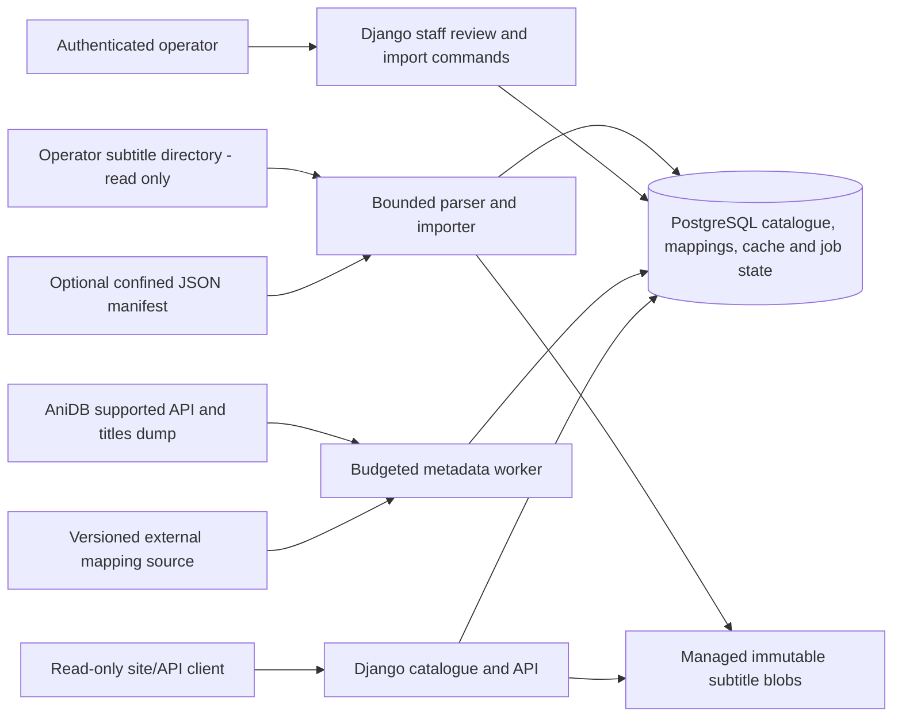

# Proposed architecture and trust boundaries

Status: approved direction; implementation must document the final concrete schema and limits.

## Boundaries

- Public web requests may read only published catalogue records and safe file downloads. They do not launch live metadata fan-out or import arbitrary paths/URLs.
- Staff authentication controls configuration, review, imports and publication. Import source roots are operator configuration, not public API arguments.
- The source directory is untrusted input despite being operator-managed. File paths, encodings, subtitle payloads and manifests are validated. Source bytes never change.
- A separate managed-file store makes a published version stable even if the source is edited/unmounted later. Catalogue revisions reference immutable blobs.
- Upstream XML/mappings are untrusted and potentially unavailable. Cache and pacing are persistent/shared, and manual mapping overrides remain authoritative.
- Import/enrichment commands share the application code and database. A second web service, distributed queue or AI dependency is not necessary for the MVP.

## Not in the first deployment

No public upload, video hosting/processing, torrent mirroring, required AniList integration, mass upstream crawl, public infrastructure change or automatic deployment. Repository publication is separate from subtitle/data publication.
